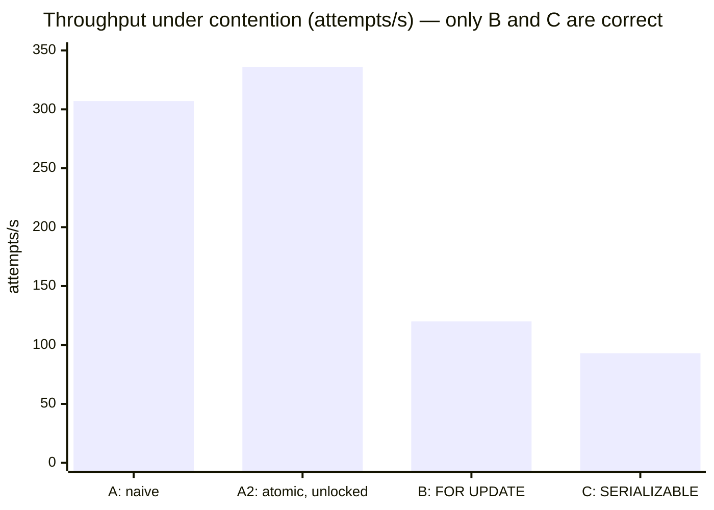

# Ledger Engine

**A financial ledger that never loses a cent:** ACID double-entry accounting, idempotent transfers, and correctness you can check under heavy concurrent load.

Every money movement is recorded as balanced, append-only debit/credit entries in PostgreSQL. Transfers are atomic, retries are safe (idempotency keys), and the system's core invariant — *the sum of all balances never changes* — is asserted by a stress test that fires tens of thousands of overlapping transfers.

> **Status:** Phase 3 complete. 51,200 concurrent transfers with zero invariant violations, a measured isolation-level experiment, and a paginated statement API. 51 tests in the default suite + 3 stress/experiment suites, all against real Postgres.

## Stack

Java 21 · Spring Boot 4 · PostgreSQL 16 · Flyway · plain SQL via `JdbcClient` (deliberately no ORM) · JUnit 5 + Testcontainers · Docker Compose · GitHub Actions

## Correctness guarantees

Each invariant is defined, enforced at a named layer, and proved by a named test in [docs/CORRECTNESS_INVARIANTS.md](docs/CORRECTNESS_INVARIANTS.md):

| # | Invariant | Enforced by | Proved by |
|---|---|---|---|
| I1 | Every transaction's entries sum to zero | App + deferred DB constraint trigger at COMMIT | `SchemaGuardsIT`, stress test |
| I2 | Σ balances = 0 per currency, in *every* committed snapshot | I1 + same-transaction balance updates | stress test with a live sampler (2,301 snapshots) |
| I3 | Cached balance = Σ of the account's log entries | Log and cache written in one DB transaction under row lock | `LedgerAssertions` reconciliation query |
| I4 | User accounts never go negative | Funds check on the **locked** row + DB `CHECK` backstop | stress test (requires rejections > 0) |
| I5 | Exactly one transfer per `Idempotency-Key` | Key claimed first, inside the transfer's own DB transaction | 50-thread same-key race, stress retries |
| I6 | The log is append-only | `UPDATE`/`DELETE`/`TRUNCATE` triggers | `SchemaGuardsIT` |
| I7 | No lost updates, no deadlocks | `FOR UPDATE` in one global lock order | stress test: every balance recomputed client-side |

Every concurrency test was **mutation-checked**, meaning it was run against deliberately broken code to prove it can fail. Removing `FOR UPDATE` makes the stress test fail (overdrafts race into the `CHECK` backstop). Reversing the lock order makes the deadlock test fail with `deadlock detected`. That process also caught a test that *couldn't* fail: with 2 threads the deadlock test passed against a broken lock order (a lock-step convoy), so it now uses 8.

### Result: 51,200 concurrent transfers

32 threads × 1,600 random transfers over **10 hot accounts** (maximum contention), 5% client retries:

| Committed | Idempotent replays | `insufficient_funds` | Unexpected errors / deadlocks | Invariant violations |
|---|---|---|---|---|
| 47,703 | 2,491 | 1,006 | **0** | **0** (I1–I5, I7) |

### Experiment: why `FOR UPDATE`, and not a weaker or stricter isolation level?

The same contended workload (8,000 attempts, 16 threads, 6 accounts) against four implementations of the balance step:

| Variant | What goes wrong | Committed | Anomalies | Throughput |
|---|---|---|---|---|
| **A.** Unlocked read → compute in Java → write (READ COMMITTED) | **Lost updates** | 7,643 | cached ≠ log on **6/6 accounts, drift 4,185,301** | 307/s |
| **A2.** Unlocked funds check → atomic `balance + Δ` | **Check-then-act race** | 7,094 | 0 drift, but **333 overdrafts** stopped only by the DB `CHECK` | 336/s |
| **B.** `FOR UPDATE` in lock order (**production**) | nothing | 7,176 | **0** | 120/s |
| **C.** SERIALIZABLE, no locks, retry on `40001` | throughput under contention | 5,714 | **0**, but 13,905 retries and **1,392 transfers abandoned** after 10 attempts | 93/s |



**Takeaways**
- Atomic in-place increments (A2) fix lost updates but not the overdraft race. The funds check must read a **locked** row.
- SERIALIZABLE (C) is correct, but on hot accounts it turns contention into aborts: 17% of transfers gave up even with 10 retries. Pessimistic locking queues work instead of discarding it.
- Correctness isn't free: B runs at ~40% of the broken variants' throughput under this extreme contention, because row locks are held across several network round trips.
- A first version of this experiment wrote rows in from→to order, and the unlocked variants **deadlocked on 36–41% of attempts**. That's the lock-ordering lesson (I7) seen from the other side.

### Load numbers

| Test | Throughput | p50 / p95 / p99 latency |
|---|---|---|
| Service level, 32 threads, 10 hot accounts | 157 req/s (146 committed/s) | 134 / 620 / 771 ms |
| Real HTTP, 16 clients, 10 hot accounts | 141 req/s | 53 / 410 / 558 ms |

Measured on a laptop, with the JVM in a Docker Desktop container reaching Postgres through `host.docker.internal`. Every SQL round trip crosses the VM network boundary, and all traffic targets 10 rows on purpose, so treat these as a **worst-case, contention-bound floor**, not peak capacity. The manual **Stress** GitHub Actions workflow reruns everything on a Linux runner and publishes the reports.

### Tradeoffs and what I'd do next
- **Shorter lock hold time:** the transfer holds row locks across ~7 round trips. Collapsing steps 3–7 into one SQL statement or function would cut hold time, and throughput on hot accounts should rise roughly proportionally.
- **Hot-account sharding:** for a single very hot account (e.g. a merchant), split its balance across N sub-accounts.
- **Reconciliation job:** schedule the I3 query and expose it as a health indicator.

## Design

- [HLD](docs/HLD.md): architecture, transfer data flow, concurrency strategy, tech rationale
- [LLD](docs/LLD.md): packages, the transfer algorithm, locking and idempotency details
- [Data models](docs/DATA_MODELS.md) · [API contracts](docs/API_CONTRACTS.md)

## Run it

```bash
docker compose up -d --build
curl http://localhost:8080/actuator/health
```

Try it (amounts are minor units: `1000` = ₹10.00; money enters from the INR system account `…0001`):

```bash
# create an account → note its "id"
curl -s -H 'Content-Type: application/json' -d '{"name":"Alice","currency":"INR"}' localhost:8080/accounts

# fund it (201). Send the same request again → 200 + "Idempotent-Replayed: true", no second credit
curl -si -H 'Content-Type: application/json' -H 'Idempotency-Key: fund-alice-1' \
  -d '{"fromAccountId":"00000000-0000-0000-0000-000000000001","toAccountId":"<alice-id>","amount":1000,"currency":"INR"}' \
  localhost:8080/transfers

curl -s localhost:8080/accounts/<alice-id>     # "balance": 1000
```

## Test it

```bash
./mvnw verify            # 51 unit + integration tests; requires Docker (Testcontainers spins up a real Postgres)
./mvnw verify -Pstress   # 51k-transfer stress test, HTTP load test, isolation experiment (~10+ min); reports in target/*-report.md
```

Statement for an account, newest first: `GET /accounts/{id}/entries?limit=50&before=<nextCursor>`.
