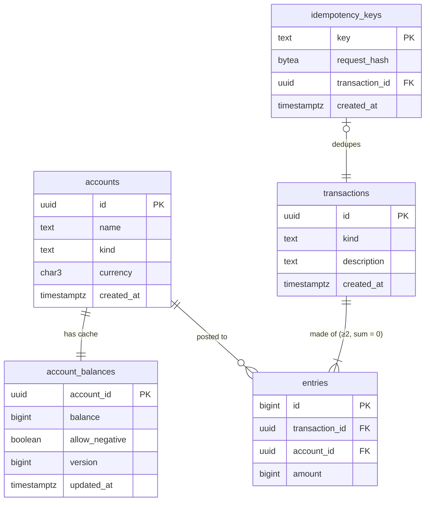

# Data Models

MVP schema, landing as Flyway migration `V2__ledger_schema.sql` in Phase 2. Invariant IDs (I1–I7) refer to [CORRECTNESS_INVARIANTS.md](CORRECTNESS_INVARIANTS.md).

## 1. Conventions

- **Money:** `BIGINT` minor units (paise for INR, cents for USD). The Java type is `long`. There are no floats and no `NUMERIC`.
- **Sign:** an entry's `amount` is signed. Negative means value leaves the account (debit of the source); positive means value arrives (credit of the destination). A balance is the plain sum of its entries.
  *This is deliberately simpler than textbook "normal balance" accounting (asset vs liability sides). Every account here is a holder of value. Full chart-of-accounts semantics are a non-goal ([HLD.md](HLD.md) §8).*
- **Amount bounds:** `1 ≤ amount ≤ 10^15` (1e15 < 2^53, so values stay exact in JSON/JavaScript clients, and no sum of realistic balances overflows `BIGINT`).
- **Currencies (MVP):** `INR`, `USD`. A transfer is single-currency; there is no FX.
- **IDs:** `UUID` for everything exposed through the API (`gen_random_uuid()`, built into PG13+). `entries.id` is an internal `BIGINT` identity, used for ordering and keyset pagination.
- **Time:** `TIMESTAMPTZ`, set by the DB (`now()`, which is the transaction start time).

## 2. Tables

### `accounts` — immutable account metadata
| Column | Type | Constraints |
|---|---|---|
| `id` | `UUID` | PK, default `gen_random_uuid()` |
| `name` | `TEXT` | NOT NULL, 1–100 chars |
| `kind` | `TEXT` | NOT NULL, `CHECK (kind IN ('USER','SYSTEM'))` |
| `currency` | `CHAR(3)` | NOT NULL, `CHECK (currency IN ('INR','USD'))` |
| `created_at` | `TIMESTAMPTZ` | NOT NULL, default `now()` |

### `account_balances` — the hot, mutable cache row (one per account)
Kept separate from `accounts` so the only thing locked and rewritten per transfer is a small row, and metadata reads never contend with transfers.

| Column | Type | Constraints |
|---|---|---|
| `account_id` | `UUID` | PK, FK → `accounts.id` |
| `balance` | `BIGINT` | NOT NULL, default 0 |
| `allow_negative` | `BOOLEAN` | NOT NULL. `true` iff the account is SYSTEM, copied at creation so the CHECK needs no join |
| `version` | `BIGINT` | NOT NULL, default 0, incremented on every change. Used for the Phase 3 optimistic-locking variant and handy for debugging |
| `updated_at` | `TIMESTAMPTZ` | NOT NULL, default `now()` |
| | | `CHECK (allow_negative OR balance >= 0)` (the **I4 backstop**) |

### `transactions` — one row per money movement (append-only)
| Column | Type | Constraints |
|---|---|---|
| `id` | `UUID` | PK. **Generated in the app** before insert (needed by the idempotency row, see [LLD.md](LLD.md) §5) |
| `kind` | `TEXT` | NOT NULL, `CHECK (kind = 'TRANSFER')` (the MVP has one kind; the column leaves room for reversals and fees) |
| `description` | `TEXT` | NULL, ≤ 255 chars |
| `created_at` | `TIMESTAMPTZ` | NOT NULL, default `now()` |

### `entries` — the ledger lines (append-only)
| Column | Type | Constraints |
|---|---|---|
| `id` | `BIGINT` | PK, `GENERATED ALWAYS AS IDENTITY` |
| `transaction_id` | `UUID` | NOT NULL, FK → `transactions.id` |
| `account_id` | `UUID` | NOT NULL, FK → `accounts.id` |
| `amount` | `BIGINT` | NOT NULL, `CHECK (amount <> 0)` |

Indexes: `(account_id, id)` for the statement API (keyset pagination) and per-account reconciliation; `(transaction_id)` for loading a transfer and for the I1 trigger.

### `idempotency_keys`
| Column | Type | Constraints |
|---|---|---|
| `key` | `TEXT` | PK, 1–255 chars. Global scope, because the MVP has no auth/tenants |
| `request_hash` | `BYTEA` | NOT NULL, SHA-256 of the canonical request ([LLD.md](LLD.md) §5) |
| `transaction_id` | `UUID` | NOT NULL, FK → `transactions.id` **`DEFERRABLE INITIALLY DEFERRED`**, because this row is inserted *before* the transaction row within the same DB transaction |
| `created_at` | `TIMESTAMPTZ` | NOT NULL, default `now()` |

Retention: keys are kept forever in the MVP. A TTL sweep (e.g. 24 h, as Stripe does) is a later concern.

## 3. Triggers (DB-level backstops)

| Trigger | On | Timing | Purpose |
|---|---|---|---|
| `entries_balanced` | `entries` AFTER INSERT, FOR EACH ROW, `CONSTRAINT TRIGGER … DEFERRABLE INITIALLY DEFERRED` | at COMMIT | For `NEW.transaction_id`: raise `23514` unless `SUM(amount) = 0`, `COUNT(*) ≥ 2`, and `COUNT(DISTINCT accounts.currency) = 1` (**I1**) |
| `transactions_append_only`, `entries_append_only` | BEFORE UPDATE OR DELETE, FOR EACH ROW | immediate | `RAISE EXCEPTION` (**I6**) |
| `transactions_no_truncate`, `entries_no_truncate` | BEFORE TRUNCATE, FOR EACH STATEMENT | immediate | `RAISE EXCEPTION` (**I6**) |

The trigger fires once per entry row, so a 2-entry transaction runs the check twice at commit. That is acceptable for the MVP (it's an indexed lookup on `transaction_id`). If benchmarks show it matters, dedupe the check.

## 4. Seed data (in V2)

One SYSTEM account per currency, with fixed well-known IDs, so clients and tests can fund accounts:

| id | name | currency |
|---|---|---|
| `00000000-0000-0000-0000-000000000001` | `system:INR` | INR |
| `00000000-0000-0000-0000-000000000002` | `system:USD` | USD |

Both have `allow_negative = true`. Depositing to a user = a transfer from the SYSTEM account to that user.

## 5. ER diagram



## 6. Java domain records (`com.mukundagrawal.ledger.domain`)

```java
enum AccountKind { USER, SYSTEM }
enum Currency { INR, USD }

record Account(UUID id, String name, AccountKind kind, Currency currency,
               long balance, long version, Instant createdAt) {}      // read model: accounts ⋈ account_balances

record Entry(long id, UUID transactionId, UUID accountId, long amount) {}

record Transfer(UUID id, UUID fromAccountId, UUID toAccountId, long amount,
                Currency currency, String description, Instant createdAt) {}  // derived from a transaction + its 2 entries

record TransferCommand(String idempotencyKey, UUID fromAccountId, UUID toAccountId,
                       long amount, Currency currency, String description) {}   // service input, already validated for shape
```

`Transfer` is a **view** reconstructed from `transactions` + `entries` (the negative entry gives `from`, the positive one gives `to`). There is no separate `transfers` table, so there is nothing that could drift from the log.
