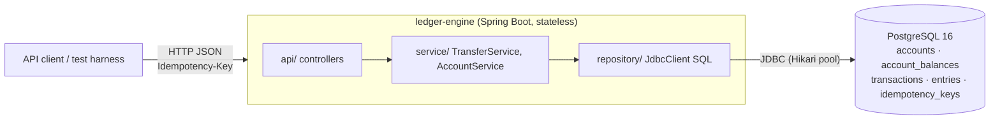
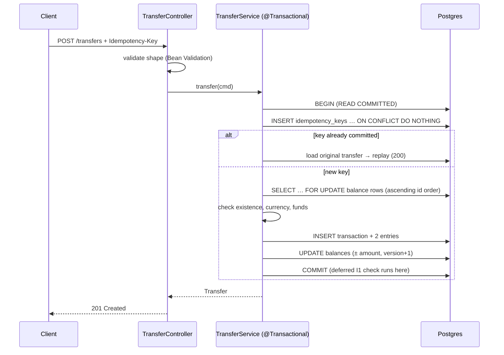

# High-Level Design — Ledger Engine

## 1. Problem & goals

Build a ledger service that moves money between accounts and **never loses or creates a cent**, even when thousands of transfers hit the same accounts at once and clients retry on timeouts.

**MVP goals**
1. Accounts with a current balance, in INR or USD.
2. Atomic transfers: the debit and the credit either both happen or neither does.
3. An immutable audit log: every balance can be recomputed from the log.
4. Idempotent transfer API: a retried request never double-charges.
5. Every correctness claim is **proved by an automated test against real Postgres** ([CORRECTNESS_INVARIANTS.md](CORRECTNESS_INVARIANTS.md)).

**Quality targets** (to be measured in Phase 3, not guessed): ≥ 50k concurrent transfers with 0 invariant violations, plus throughput and p50/p95/p99 latency reported in the README.

## 2. System context

The app is **stateless**. All coordination (locks, uniqueness, atomicity) is delegated to Postgres, so the app can scale horizontally without any change to the correctness argument. That property is why every guarantee below is phrased in terms of DB transactions, not JVM locks. A `synchronized` block would silently break the moment a second instance starts.

## 3. Core model: double-entry

- An **account** holds value in one currency.
- A **transaction** is one business event (a transfer). It owns ≥ 2 **entries**.
- An **entry** is a signed amount posted to one account. The entries of a transaction always sum to **zero**.
- An account's **balance** is the sum of its entries. `account_balances` caches that sum for O(1) reads and for locking.
- Money enters the system only by moving out of a per-currency **SYSTEM account**, which may go negative. So *Σ all balances = 0* per currency, always. That single number is the conservation check (I2).

Why double-entry rather than a single `balance` column you add to and subtract from? With one column you cannot tell where money went, you cannot audit it, and a partial write (debit applied, credit lost) is invisible. With double-entry, every movement has two sides that must net to zero, and the DB refuses to commit anything else. Corruption becomes *detectable* (and here, *preventable*) instead of silent.

## 4. Transfer data flow (happy path)

Step-by-step detail, including every failure branch, is in [LLD.md](LLD.md) §3.

## 5. Concurrency strategy

**The hazards.** Two transfers from the same account can both read balance = 100, both pass a "≥ 80?" check, and both commit, leaving −60 (a check-then-act race). Two naive read-modify-writes can overwrite each other (a lost update). Two transfers A→B and B→A can each lock one row and wait for the other (a deadlock).

**The chosen approach: pessimistic row locks under READ COMMITTED.**
- Inside the transfer's DB transaction, lock **both** `account_balances` rows with `SELECT … FOR UPDATE` **before** reading the balance used for the funds check. A second transfer touching either account waits, then sees the committed result.
- Always lock in **ascending account-id order**, so no two transfers can wait on each other in a cycle, which rules out deadlock.
- Write balances as `balance = balance + :delta` while holding the lock.

**Why not the alternatives (in the MVP)?**
| Option | Verdict |
|---|---|
| SERIALIZABLE, no explicit locks | Correct, but under a hot-account workload it turns contention into **serialization failures** that the app must retry, so throughput gets worse exactly when load peaks. Run as an experiment in Phase 3 to *measure* that cost rather than assume it. |
| Optimistic locking (`version` compare-and-set) | Good for low contention. Hot accounts cause retry storms. The `version` column is kept so this can be benchmarked too. |
| App-level locks (`synchronized`, Redis locks) | Breaks with >1 instance, or adds a second system whose failure modes can violate DB invariants. Rejected. |

**Idempotency under concurrency.** The idempotency row is the *first* write in the transaction, and its PRIMARY KEY does the deduplication: a concurrent duplicate blocks on the uncommitted key until the first request commits (→ replay) or rolls back (→ proceed). There is no separate "in-flight" state, so a crash in the middle can't leave a key stuck. Key insert always happens before balance locks, which keeps the global lock order consistent (key → balances ascending).

**Defence in depth.** App checks give good error messages. DB constraints make the invariants impossible to violate even through a buggy code path: a deferred balance trigger (I1), `CHECK balance ≥ 0` for USER accounts (I4), and append-only triggers (I6).

## 6. Technology choices

| Concern | Choice | Rationale |
|---|---|---|
| Language/framework | Java 21 + Spring Boot 4.1 | Standard in fintech backends; declarative transactions; the virtual-threads option is available for later benchmarking |
| Database | PostgreSQL 16 | Real row locks, all isolation levels including true SERIALIZABLE (SSI), deferred constraint triggers, transactional DDL |
| Data access | Spring `JdbcClient`, hand-written SQL | Every lock, isolation level and statement order is explicit and reviewable. An ORM's dirty checking, flush ordering and lazy loading hide exactly the things this project exists to control |
| Migrations | Flyway | Versioned, reviewable schema history, with triggers/constraints living in SQL next to the tables |
| Tests | JUnit 5 + Testcontainers | H2 or mocks can't reproduce Postgres locking/isolation, so a passing test there proves nothing |
| Errors | RFC 9457 ProblemDetail | Standard, with a stable machine-readable `code` |
| Packaging | Docker Compose | One-command run: `docker compose up` |

## 7. Failure modes considered

| Failure | Outcome |
|---|---|
| App crashes mid-transfer | The DB transaction rolls back and nothing is partially written; the idempotency key isn't consumed, so the client's retry executes normally |
| Client times out, then retries | The retry returns the original result (replay) or, if the first attempt rolled back, executes once |
| Two identical requests race | One commits; the other blocks on the key, then replays (I5) |
| Hot account contention | Requests queue on the row lock. `lock_timeout` (5 s) bounds the wait and maps to `503 service_busy` so clients back off instead of piling up |
| Bug writes an unbalanced or overdrawing transaction | Rejected by DB triggers/constraints at commit; surfaces as a 500 and a failing invariant test, never as silent corruption |

## 8. Non-goals (MVP)

Authentication/authorization and multi-tenancy · FX / multi-currency transfers · textbook chart-of-accounts debit/credit normal balances · holds/authorisations and two-phase payments · reversals/refunds as first-class operations (the log supports them later as compensating transactions) · idempotency-key TTL · sharding / multi-region · event streaming out of the ledger.

## 9. Roadmap

- **Phase 2 (vertical slice):** V2 schema, `POST/GET /accounts`, `POST/GET /transfers` with idempotency, and ITs for I1–I4 and I6.
- **Phase 3 (depth):** concurrency stress test (51,200 transfers), isolation-level experiment, statement API, reconciliation job, benchmarks.
- **Later:** deploy (Fly.io/AWS), multi-currency, Grafana dashboard.
